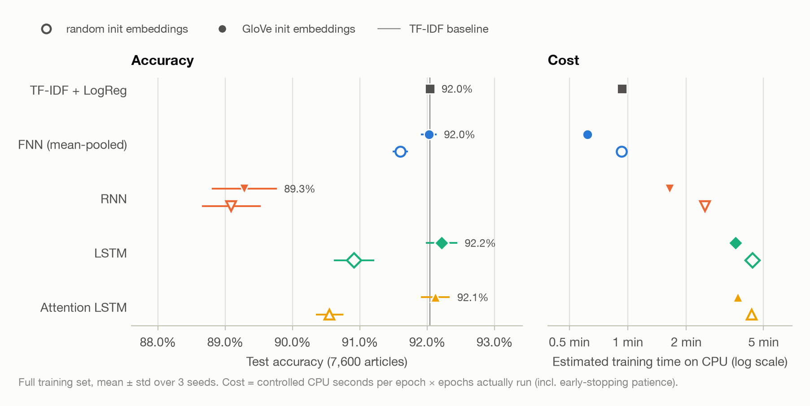
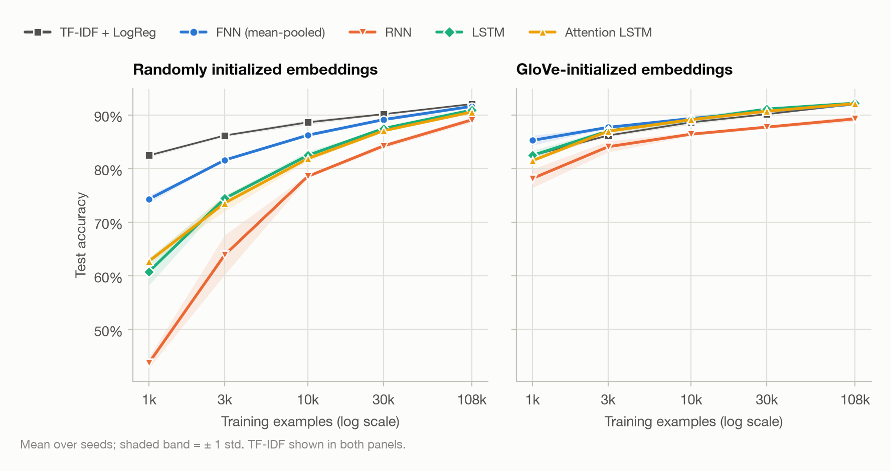
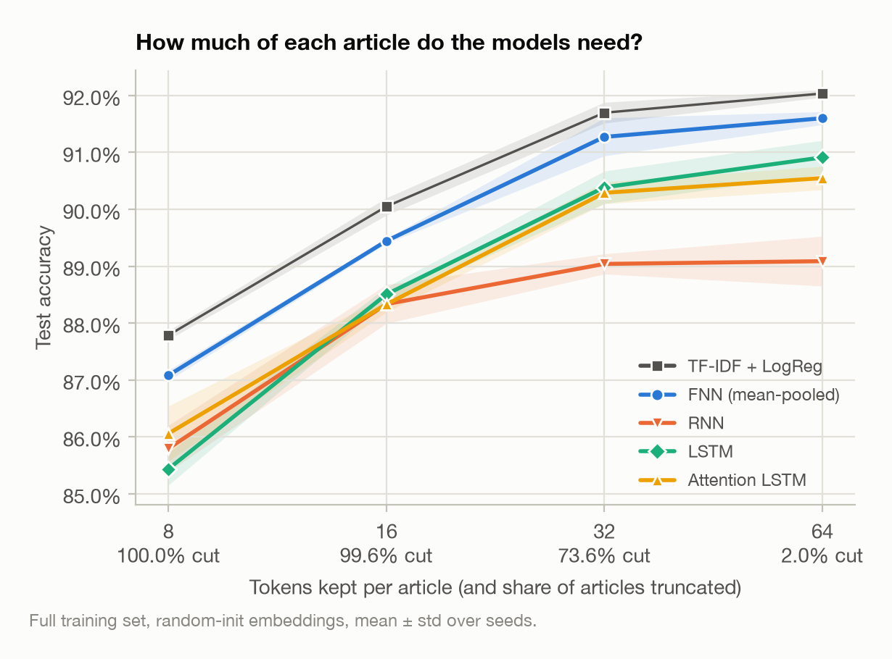
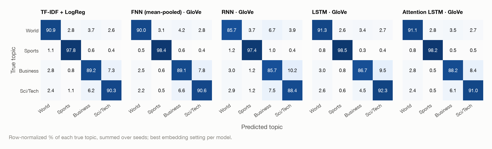
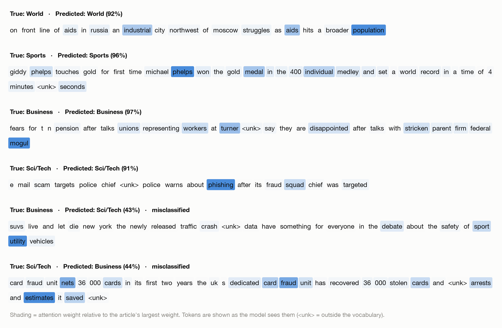

# Does word order matter for news topic classification?

[](https://github.com/Yusufb7841/Python-for-NLP/actions/workflows/ci.yml)


A controlled comparison of four neural text classifiers — a mean-pooled embedding **FNN**
that ignores word order, a vanilla **RNN**, an **LSTM**, and an **LSTM with attention** —
against a classic **TF-IDF + logistic regression** baseline on the AG News topic
classification benchmark (4 classes, 120k training / 7.6k test articles).

Every configuration is trained with 3 seeds on the full dataset, with random and
GloVe-initialized embeddings, across 5 training-set sizes and 4 input lengths
(180 training runs). Every number and figure on this page is produced by a script from
[`results/runs.csv`](results/runs.csv).

## Key findings

- **Word order adds almost nothing here.** On the full data, the GloVe LSTM
  (92.21 ± 0.23%), the order-blind GloVe FNN (92.02 ± 0.11%) and TF-IDF + logistic
  regression (92.04 ± 0.07%) are within seed-to-seed noise. Seed by seed, no neural model
  beats TF-IDF by more than 0.3 points.
- **Pretrained embeddings matter more than architecture.** GloVe adds 1.3–1.6 points to the
  LSTM models but only 0.4 to the FNN. With 1,000 training examples, it lifts the LSTM from
  60.8% to 82.5%.
- **More data narrows the gap but never reverses it.** With random embeddings, the LSTM
  trails the FNN by 13.5 points at 1k examples and by 0.7 at 108k. With GloVe, the FNN
  leads up to 10k examples, and beyond that the two are within 0.7 points of each other.
- **The headline carries most of the signal.** The first 8 tokens (roughly the headline)
  alone give 85–88% accuracy. The vanilla RNN stops improving after 32 tokens.
- **The LSTM models take about 6× longer to train than the FNN.** On a laptop CPU,
  TF-IDF fits in under a minute and the GloVe FNN trains in 0.6 minutes, against 3.6
  minutes for the GloVe LSTM.

## Results

### Main comparison

<picture>
  <source media="(prefers-color-scheme: dark)" srcset="results/figures/main_results-dark.png">
  
</picture>

<!-- BEGIN table:main -->
| Model | Embeddings | Test accuracy (%) | Macro F1 (%) | Best epoch | CPU train time (min) | Params excl. embeddings |
| :----------------- | :---------- | ------------: | ------------: | -----: | -----: | ----------: |
| TF-IDF + LogReg | n/a | 92.04 ± 0.07 | 92.02 ± 0.07 | n/a | 0.9 | n/a |
| FNN (mean-pooled) | GloVe | 92.02 ± 0.11 | 92.01 ± 0.11 | 4.3 | 0.6 | 13,444 |
| FNN (mean-pooled) | random | 91.60 ± 0.11 | 91.59 ± 0.11 | 8.0 | 0.9 | 13,444 |
| RNN | GloVe | 89.28 ± 0.48 | 89.26 ± 0.48 | 4.7 | 1.6 | 29,956 |
| RNN | random | 89.09 ± 0.44 | 89.07 ± 0.45 | 8.7 | 2.5 | 29,956 |
| LSTM | GloVe | 92.21 ± 0.23 | 92.19 ± 0.24 | 3.0 | 3.6 | 118,276 |
| LSTM | random | 90.91 ± 0.30 | 90.90 ± 0.29 | 4.3 | 4.4 | 118,276 |
| Attention LSTM | GloVe | 92.12 ± 0.22 | 92.11 ± 0.21 | 2.7 | 3.7 | 134,916 |
| Attention LSTM | random | 90.55 ± 0.21 | 90.53 ± 0.19 | 3.7 | 4.3 | 134,916 |
<!-- END table:main -->

Mean ± standard deviation over 3 seeds on the full 7,600-article test set (at this test
size, one standard error of an accuracy near 92% is about 0.3 points). *CPU train time* is
the controlled per-epoch time from the timing benchmark multiplied by the number of epochs
each configuration actually ran, including the 3 early-stopping patience epochs.

### Do the sequence models just need more data?

<picture>
  <source media="(prefers-color-scheme: dark)" srcset="results/figures/learning_curve-dark.png">
  
</picture>

<!-- BEGIN table:learning_curve -->
| Model | Embeddings | 1,000 | 3,000 | 10,000 | 30,000 | 108,000 (all) |
| :----------------- | :---------- | -----: | -----: | ------: | ------: | -------: |
| TF-IDF + LogReg | n/a | 82.5 | 86.2 | 88.6 | 90.2 | 92.0 |
| FNN (mean-pooled) | GloVe | 85.3 | 87.7 | 89.3 | 90.7 | 92.0 |
| FNN (mean-pooled) | random | 74.3 | 81.6 | 86.2 | 89.1 | 91.6 |
| RNN | GloVe | 78.2 | 84.1 | 86.4 | 87.8 | 89.3 |
| RNN | random | 43.8 | 63.9 | 78.5 | 84.2 | 89.1 |
| LSTM | GloVe | 82.5 | 87.0 | 89.1 | 91.1 | 92.2 |
| LSTM | random | 60.8 | 74.5 | 82.5 | 87.5 | 90.9 |
| Attention LSTM | GloVe | 81.5 | 87.0 | 89.1 | 90.7 | 92.1 |
| Attention LSTM | random | 62.8 | 73.6 | 81.9 | 87.1 | 90.5 |
<!-- END table:learning_curve -->

Test accuracy (%), mean over 3 seeds. With random embeddings, every neural model trails
TF-IDF at every size, and the recurrent models need the most data to catch up. GloVe
closes most of that gap. The GloVe FNN beats TF-IDF on every seed up to 30k examples.

### How much of each article is needed?

AG News articles are short: a median of 38 tokens, with only 2% longer than 64. To find
out where the signal sits, every model is retrained seeing only the first 8, 16, 32 or
64 tokens.

<picture>
  <source media="(prefers-color-scheme: dark)" srcset="results/figures/sequence_length-dark.png">
  
</picture>

<!-- BEGIN table:sequence_length -->
| Model | 8 tokens | 16 tokens | 32 tokens | 64 tokens |
| :----------------- | ------: | ------: | ------: | ------: |
| TF-IDF + LogReg | 87.8 | 90.0 | 91.7 | 92.0 |
| FNN (mean-pooled) | 87.1 | 89.4 | 91.3 | 91.6 |
| RNN | 85.8 | 88.3 | 89.0 | 89.1 |
| LSTM | 85.4 | 88.5 | 90.4 | 90.9 |
| Attention LSTM | 86.1 | 88.3 | 90.3 | 90.5 |
<!-- END table:sequence_length -->

Test accuracy (%), random-init embeddings, mean over 3 seeds. The order of the models is
the same at every length. The LSTM gains the most from longer inputs (+5.5 points from 8
to 64 tokens) but never catches the FNN, and the plain RNN stops improving after 32
tokens.

### Where the models go wrong

<picture>
  <source media="(prefers-color-scheme: dark)" srcset="results/figures/confusion_matrices-dark.png">
  
</picture>

Per-class F1 (%), mean over seeds:

<!-- BEGIN table:per_class -->
| Model | Embeddings | World | Sports | Business | Sci/Tech |
| :----------------- | :---------- | -----: | ------: | --------: | --------: |
| TF-IDF + LogReg | n/a | 92.2 | 96.6 | 89.3 | 90.0 |
| FNN (mean-pooled) | GloVe | 92.2 | 97.1 | 88.8 | 89.9 |
| FNN (mean-pooled) | random | 91.8 | 96.9 | 88.3 | 89.3 |
| RNN | GloVe | 88.9 | 95.7 | 85.3 | 87.1 |
| RNN | random | 89.4 | 95.3 | 84.9 | 86.7 |
| LSTM | GloVe | 92.3 | 97.3 | 89.0 | 90.1 |
| LSTM | random | 91.3 | 96.1 | 87.8 | 88.5 |
| Attention LSTM | GloVe | 92.4 | 97.2 | 88.9 | 89.8 |
| Attention LSTM | random | 90.9 | 95.7 | 87.2 | 88.4 |
<!-- END table:per_class -->

### What does the attention layer look at?

<picture>
  <source media="(prefers-color-scheme: dark)" srcset="results/figures/attention_examples-dark.png">
  
</picture>

The weights often land on topical words (*phelps*, *medal*, *phishing*, *fraud*). But
across the test set, the GloVe model puts 19.3% of its attention on the first 8 tokens
(roughly the headline) and 24.7% on the last 8, where uniform attention would give 22.4%
to each ([`results/attention_stats.txt`](results/attention_stats.txt)). Each LSTM state
summarizes everything to its left, so late states have already read the headline. The
weights show where the model pools information, not which word caused the prediction.

### Training cost

Seconds per training epoch over the full 108k-example training split, measured one model
at a time on an otherwise idle Apple M2 laptop (8 cores, 16 GB, PyTorch 2.15 with its
default 4 CPU threads):

<!-- BEGIN table:timing -->
| Model | CPU s/epoch | MPS s/epoch |
| :----------------- | -------: | -------: |
| FNN (mean-pooled) | 5.1 | 6.2 |
| RNN | 12.8 | 28.2 |
| LSTM | 35.9 | 18.6 |
| Attention LSTM | 39.1 | 21.1 |

TF-IDF + LogReg: 56 s for a full CPU fit (including the C search).
<!-- END table:timing -->

On the CPU, cost follows model complexity. On Apple's MPS backend, the LSTM runs about
twice as fast as on the CPU and the plain RNN about twice as slow, so the RNN ends up
slower than the LSTM. The original version of this project reported that ordering as a
property of the models, but it is a property of the backend.

## Method

| | |
|:--|:--|
| **Data** | AG News via Hugging Face `datasets` (downloaded on first run, not redistributed here). The official 120k training set is split 90/10 (stratified, per seed) into train and validation; the official 7.6k test set is used only for final evaluation. |
| **Preprocessing** | AG News' broken HTML entities (`#39;`, `quot;`, `&lt;b&gt;`) are repaired, then text is lowercased and split into word/number tokens. Vocabulary: the 20k most frequent training tokens seen at least twice. |
| **Models** | Shared 100-d embeddings and 128-d hidden size. FNN = masked mean of embeddings → MLP. RNN / LSTM = hidden state at the last real token. Attention LSTM = additive attention pooling over all LSTM states. Dropout 0.2 before the classifier. |
| **Embeddings** | Random init, or initialized from [GloVe 6B 100d](https://nlp.stanford.edu/projects/glove/) (99% vocabulary coverage) and fine-tuned. |
| **Baseline** | TF-IDF over unigrams + bigrams (sublinear TF, min_df 2) with logistic regression, C chosen on validation. |
| **Training** | Adam (lr 1e-3), batch 64, gradient clipping at 1.0, up to 30 epochs. Early stopping on validation accuracy with patience 3; the best-validation weights are evaluated on test. |
| **Evaluation** | Accuracy and macro F1 on the full test set, mean ± std over seeds 0, 1, 2. Learning-curve subsets are stratified samples of the training split; the validation set stays fixed. |

Hyperparameters are shared by every model (see [`src/agnews/config.py`](src/agnews/config.py))
and were not tuned per model.

## Reproducing

```bash
git clone https://github.com/Yusufb7841/Python-for-NLP.git && cd Python-for-NLP
make setup        # .venv with pinned dependencies (or: pip install -r requirements.txt)
make test         # unit tests, synthetic data only, ~5 s
make results      # GloVe download, all 180 runs, timing benchmark, figures, tables, PDF
```

The 180 runs add up to about 4.5 hours of training on an Apple M2 (measured with three
workers sharing the machine, see below). The sweep is resumable: finished runs are
recorded in `results/runs.csv` and skipped on restart. Individual steps:

```bash
python -m agnews.experiments --suites main --seeds 0      # one suite / seed
python -m agnews.experiments --models fnn tfidf --dry-run  # list pending runs
python -m agnews.benchmark                                 # timing table
python -m agnews.figures && python -m agnews.attention_viz
python -m agnews.summary                                   # refresh tables in this README
```

Several worker processes can share the sweep: give them disjoint `--models` lists, or
let a second worker take the same queue from the other end with `--reverse` (appends to
the results file are locked). The results here came from three workers on one laptop,
with LSTM-based models mostly on Apple's MPS backend and everything else on CPU; the
device used for each run is recorded in `results/runs.csv`.

## Project structure

```
src/agnews/
  data.py           cleaning, tokenization, vocabulary, stratified splits, batching
  models.py         FNN, RNN/LSTM, Attention LSTM
  embeddings.py     GloVe download + embedding matrix
  baselines.py      TF-IDF + logistic regression
  training.py       training loop, early stopping, prediction
  experiments.py    experiment suites -> results/runs.csv, results/history.csv
  benchmark.py      controlled timing -> results/timing.csv
  figures.py        all plots (light + dark)
  attention_viz.py  attention heatmaps
  summary.py        tables -> results/summary.md, README.md, reports/report.md
tests/              pytest suite (runs in CI on every push)
reports/            write-up (report.md -> report.pdf)
```

## What changed from the original version

This project started as a course assignment built in about three hours
([original version](https://github.com/Yusufb7841/Python-for-NLP/tree/v1.0-course)).
Reviewing it afterwards turned up problems that changed its conclusions, so it was
rebuilt:

| v1 (course submission) | v2 (this version) |
|:--|:--|
| 10k of 120k training examples, 2k of 7.6k test examples | Full training and test sets, plus a learning curve over 1k–108k |
| One seed; differences of 1–3 points reported as "clearly better" | 3 seeds, mean ± std; with 2k test examples the old 95% interval was already ±1.7 points |
| Sequence lengths 30 / 80 / 150. Only 0.5% of articles exceed 80 tokens and none exceed 150, so 80 vs 150 compared identical inputs | Lengths 8 / 16 / 32 / 64, chosen from the length distribution |
| Whitespace tokenization kept `#39;s`, `quot;`, `(reuters)` and `said.` as separate words | Entity repair + word tokenizer |
| RNN confusion matrix from a different run than the reported metrics (63.8% vs 67.8% accuracy) | Every table and figure is generated from one results file |
| "RNN is slower than LSTM", an artifact of PyTorch's MPS backend | Controlled timing on CPU and MPS reported separately |
| Parameter counts compared, but 99% of them were the shared embedding table | Non-embedding parameters reported |
| No baseline outside the four neural models | TF-IDF + logistic regression and GloVe embeddings |
| No tests, hand-run commands | pytest + CI, one-command reproduction |

## Limitations

- **Single dataset.** AG News is a topic task with strong keyword cues, so the conclusions
  are not expected to transfer to tasks where word order carries meaning (negation,
  sentiment, entailment).
- **Fixed hyperparameters.** All models share one configuration. A per-model search might
  narrow or widen the gaps, though the gaps are small either way.
- **No pretrained Transformer.** A fine-tuned BERT-style model would be the natural
  upper bound (about 95% on AG News in published results) and the obvious next step.
- **Attention is not explanation.** The attention weights apply to LSTM states that already
  mix in earlier words, so the heatmaps show where the model pools information, not which
  word caused a decision.

## References

- Zhang, Zhao & LeCun (2015). *Character-level Convolutional Networks for Text Classification.* NeurIPS. (AG News benchmark)
- Pennington, Socher & Manning (2014). *GloVe: Global Vectors for Word Representation.* EMNLP.
- Hochreiter & Schmidhuber (1997). *Long Short-Term Memory.* Neural Computation.
- Bahdanau, Cho & Bengio (2015). *Neural Machine Translation by Jointly Learning to Align and Translate.* ICLR.
- Joulin et al. (2017). *Bag of Tricks for Efficient Text Classification.* EACL. (fastText)
- Jain & Wallace (2019). *Attention is not Explanation.* NAACL.

The full write-up is in [`reports/report.pdf`](reports/report.pdf).
